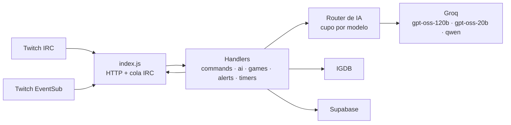
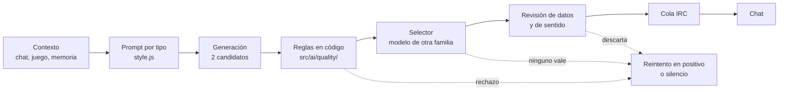

# Parlusorum Bot

[](https://github.com/perezlopezalej/parlusorum-bot/actions/workflows/test.yml)


Bot de Twitch con IA para el canal «parlusorum»: comenta el directo como un cohost, responde con datos reales de videojuegos, recuerda lo ocurrido en streams anteriores y respeta la privacidad de quien escribe en el chat.

## Qué hace

- **Cohost con criterio**: comenta jefes, muertes y rachas, y de vez en cuando saca un tema libre. Cada comentario pasa por reglas de calidad en código, un selector con otro modelo y una revisión de datos antes de llegar al chat; si ninguno convence, se calla.
- **Respuestas con datos reales**: `!dios_fua` y las menciones consultan IGDB antes de contestar, así que no inventan fechas, estudios ni países.
- **Memoria entre streams**: al acabar el directo, la IA resume lo ocurrido; los últimos resúmenes y el lore del canal (aprobado por un mod) entran en el contexto.
- **Trivia, alertas y comandos de stream**: trivia por juego con pistas y ranking, subs, raids, follows, hype train y predicciones con plantillas fijas, y comandos como `!muertes`, `!boss`, `!quemeperdi`, `!clip` o `!so`.
- **Controles en vivo**: `!fua_callate <min>` y `!fua_modo reactivo|normal` para que el streamer lo silencie o lo deje solo reactivo.
- **Privacidad por diseño**: datos por ID de Twitch, caducidad automática y borrado a petición.

## Ejemplos de mensajes

```text
Mención con datos del directo
  espectador1: @dios_fua que me perdi
  Dios_Fua:    @espectador1 Te has perdido la última muerte de Manu, lleva 12 hoy. ¡Prepárate, que el próximo FUA viene pronto!

!dios_fua con datos de IGDB (caso del eval `phantom-blade-pais`)
  espectador1: !dios_fua quien desarrollo el phantom blade 0? japoneses o chinos?
  Dios_Fua:    @espectador1 Lo desarrolló S-Game, una empresa china.

Muerte y comentario del cohost
  streamer:    !muertes +1
  Dios_Fua:    💀 Muerte #1 en este stream 😅
  Dios_Fua:    Primera caída oficial y ya estamos buscando excusas con los remakes. parlus1Kelokekelowa

Cohost y reacción del chat
  Dios_Fua:    Primera caída y el chat ya está haciendo colecta para comprarle manos nuevas a Manu.
  espectador2: JAJAJAJAJ

  Dios_Fua:    ¡Pao mandando a Manu a rezar es el mejor resumen de este directo!
  espectador3: Dios fua es el mejor jajajja

  Dios_Fua:    Doce muertes y el chat ya os quiere cobrar impuestos por revivir.
  espectador4: El dios fua es el estado ahora

Trivia
  streamer:    !trivia
  Dios_Fua:    🧠 TRIVIA: ¿Qué estudio desarrolló "Phantom Blade Zero"? (30s — habrá pistas si nadie responde)
  Dios_Fua:    💡 Pista 1: 6 letras
  streamer:    S-game
  Dios_Fua:    🎉 ¡@streamer ha acertado! 🏆 Ya es el nº 2 del ranking con 3 victorias. 💡 El juego fue desarrollado por el estudio S-Game.

Hook ante un silencio
  Dios_Fua:    ¿Sois más de cooperativo o en solitario? 💬

!quemeperdi
  Dios_Fua:    📜 Llevamos 62 min de Hell Is Us con 5 muertes. El FUA sigue vivo, el streamer no tanto 💀
```

> Hueco para una captura real del chat (los ejemplos de arriba son del chat real, con los nicks de los espectadores sustituidos): `docs/img/chat.png` (aún sin añadir).

## Arquitectura



Un mensaje generado por IA no sale directamente al chat:



## Decisiones técnicas

| Decisión | Alternativa descartada | Motivo |
|---|---|---|
| Solo Groq, con tres modelos y reservas cruzadas | Gemini como proveedor secundario | Sus términos no permiten el nivel gratuito para usuarios del EEE; los tres modelos de Groq tienen cupo propio |
| Router con cupo real por modelo (cabeceras `x-ratelimit-*`) | Un modelo para todo | Un directo de 6 h no cabe en los 200.000 tokens diarios de un solo modelo |
| El selector usa un modelo de otra familia que el generador | Que el mismo modelo se autoevalúe | Un modelo tiende a aprobar sus propios errores |
| Las prohibiciones viven en código (`src/ai/quality/`), no en el prompt | Listas de «no digas…» en el prompt | Citar lo prohibido lo introduce en el texto; el código lo rechaza sin ambigüedad |
| IGDB como única fuente de datos factuales y ficha antes del modelo | Dejar que el modelo recuerde datos de juegos | Evita fechas, estudios y países inventados |
| Plantillas fijas donde la IA no aporta (highlight, caps, encuestas) | IA en todos los mensajes | Gasta cupo y arriesga errores sin ganar nada |
| Datos por `user_id` con caducidad | Guardar nicks y mensajes sin límite | Minimiza datos personales; el nick es solo un atributo del usuario |
| Cola IRC propia y envío opcional por la API de chat | `client.say()` directo | Respeta los límites de Twitch y permite la insignia de Chat Bot |
| Render gratuito con self-ping y watchdog | Servicio de pago | Coste cero; el self-ping evita que se duerma y el watchdog reconecta el IRC |
| CommonJS sin paso de compilación | TypeScript | Despliegue y depuración sencillos para un proyecto de un solo autor |

## Cómo se prueba

- `npm test` ejecuta con `node:test` toda la suite (el recuento actual lo muestra la CI): reglas de calidad, router y cupo, EventSub, privacidad, trivia, comandos y la API pública de los módulos (`test/api-fachadas.test.js`). Las frases reales del bot que se resuelven solo con reglas están en `test/fixtures/frases-reales.json`.
- `npm run lint` pasa ESLint; la CI de GitHub Actions ejecuta lint y tests en cada push.
- `npm run eval` lanza una batería con la IA real (Groq e IGDB) sobre los handlers reales; gasta cupo, así que no va en la CI. Los casos están en `test/eval-cases.json` y el informe sale en `logs/eval.txt`.
- Las reacciones del chat a los mensajes del bot se calibran con chatlogs etiquetados a mano (`test/fixtures/reacciones-etiquetadas.json`).

## Privacidad

| Dato | Se conserva |
|---|---|
| Chat completo (`chat_log`) | 24 horas |
| Registro de calidad (mensajes del bot con contexto, nicks seudonimizados) | 30 días |
| Hechos por usuario | 90 días (contadores: 1 año sin actividad) |
| Ficha de usuario | 1 año sin actividad |

Cualquiera puede borrar lo suyo con `!fua_olvidame`; los mods, con `!fua_olvidar @usuario`; `!privacidad` lo resume en el chat. Todo se identifica por el ID de Twitch, no por el nick. Texto completo y base legal: [docs/aviso-privacidad.md](docs/aviso-privacidad.md).

## Puesta en marcha

Requisitos: Node.js 22+, una cuenta de Twitch para el bot, una aplicación en la consola de desarrolladores de Twitch y una clave de Groq. Supabase es opcional (sin ella, `NPOINT_BIN_ID`); IGDB usa el mismo `CLIENT_ID` y secreto de Twitch.

```bash
git clone https://github.com/perezlopezalej/parlusorum-bot
cd parlusorum-bot
npm install
cp .env.example .env     # nunca subas .env al repositorio
npm run bot-token        # token del bot (opcional)
npm start                # o npm run dev, con recarga
```

- Variables obligatorias: `BOT_USERNAME`, `BOT_TOKEN`, `CLIENT_ID`, `CLIENT_SECRET`, `CHANNEL`, `GROQ_API_KEY`, `BROADCASTER_TOKEN`, `EVENTSUB_SECRET` (mínimo 10 caracteres). El resto está en `.env.example`.
- El token del streamer se obtiene visitando `/auth/broadcaster` con el bot en marcha.
- Supabase: ejecuta en el SQL Editor los ficheros de `supabase/migrations/` en orden (`000` a `010`; la `011` es destructiva y va después de comprobar la `010`).
- Para EventSub en local, expón el puerto con un túnel (por ejemplo ngrok) y define `PUBLIC_URL`.
- Despliegue en Render: **New → Blueprint** sobre el repositorio (lee `render.yaml`), rellena las variables secretas y cada push a `main` despliega. Después, `npm run check:eventsub` comprueba las suscripciones.

## Estructura del repositorio

```
index.js            arranque: validación de entorno, HTTP (/health, /eventsub, /auth), cola IRC, watchdog
src/ai/             IA: handler.js (fachada) y módulos por función, style.js (prompts), quality/ (reglas),
                    factcheck.js, pick-best.js, game-sheet.js, reactions.js
src/commands/       despacho de comandos, cooldowns, permisos y ayuda
src/games/          trivia por juego y ranking
src/alerts/         subs, bits, raids, follows, lurkers y bienvenida
src/timers/         mensajes recurrentes y comentario IA
src/twitch/         Helix, IGDB, token de aplicación y envío por la API de chat
src/memory, lore/   resúmenes entre streams y lore del canal
src/privacy/        caducidad, olvido de usuarios, registro de calidad
src/utils/          estado, router de IA, almacenamiento, filtros, narrativa, logger
config/             textos, plantillas, ejemplos de estilo y lore editables sin tocar código
supabase/           migraciones SQL (000-011)
test/               node:test, fixtures y casos del eval
docs/               arquitectura de la IA, privacidad, presupuesto de Groq, auditoría y archivo
```

## Retos y aprendizajes

**Evitar que la IA se invente cosas.** El bot respondía con datos falsos sobre videojuegos. Lo resolví dándole a la IA datos reales de IGDB (primero como herramienta y ahora como ficha previa), con una comprobación de coincidencia para descartar juegos que no son el pedido. Con un LLM no basta con mejorar el prompt: hay que darle fuentes y comprobar la salida en código.

**No depender de un único modelo ni de un único cupo.** Groq retira modelos y limita tokens por modelo. El router reparte los tipos de mensaje entre tres modelos, salta al siguiente ante un 429 o un 5xx y deja callar a los mensajes espontáneos cuando no hay cupo en vez de bajar la calidad.

**Que el bot participe sin saturar el chat.** Cohost, trivia, alertas y respuestas podían pisarse. Hay topes por hora, pausas entre comportamientos, un modo «reactivo» y un control de silencio para el streamer.

**Seguridad y despliegue.** Subí credenciales al repositorio una vez y tuve que rotarlas todas. Ahora los secretos van solo en variables de entorno, Supabase usa RLS sin políticas y clave de servicio, y un fallo del watchdog que duplicaba conexiones IRC en Render está corregido y probado.

## Limitaciones y siguientes pasos

- Las últimas fases (privacidad, router con cupo real, envío por API de chat) aún no se han probado en un directo real; la lista está en [PROGRESS.md](PROGRESS.md).
- Los contadores de cupo del router viven en memoria: un reinicio los pone a cero.
- El bot no ve ni oye el directo; solo lee el chat y los eventos de Twitch.

## Autor

**Alejandro Pérez López**

- GitHub: [perezlopezalej](https://github.com/perezlopezalej)
- LinkedIn: [Alejandro Pérez López](https://www.linkedin.com/in/alejandro-alejandro-perez-dev/)

## Licencia

© 2026 Alejandro Pérez López. Todos los derechos reservados. El código es público solo para consulta; para usarlo o adaptarlo, contacta con el autor.
